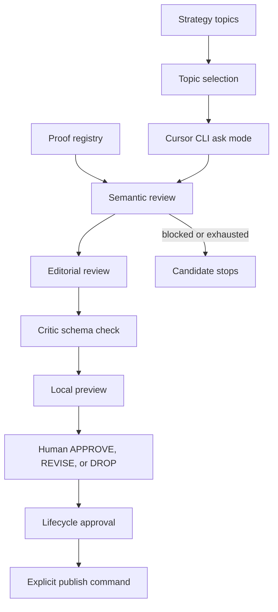

# Engineering notes

These notes describe the implementation in this repository. They are not a claim of scale, certification, or guaranteed factual correctness.

## Deterministic and probabilistic work

Probabilistic work is the model call. `scripts/cursor_runtime.py` starts the Cursor CLI in ask mode, with `--output-format json`, against a temporary workspace. The snapshot may include `knowledge/`, `docs/`, `research/`, `config/`, and `.cursor/skills/` when those directories exist. It does not copy `.env`. Secret-like environment variables are removed before the process starts, including `LINKEDIN_ACCESS_TOKEN`, `LINKEDIN_CLIENT_SECRET`, and names ending in `_TOKEN` or `_SECRET`. The default timeout is 180 seconds. A timeout kills the process tree.

Deterministic work is everything that decides whether a proposal is allowed to move forward: JSON extraction, schema keys, claim eligibility, hash checks, editorial scores, revision caps, locks, and the publish guard. Malformed model output becomes a failed cycle, not a successful review.

Tests bind a `FakeRuntime`. That is the offline path. It is not evidence that a particular model produced a good post.

## Evidence and provenance

Each registry claim has an id, a statement, a category, a source file, a verification status, and `public_safe`. The validator rejects a statement that is not present in its source markdown.

`review_body` in `scripts/content_engine.py` walks sentences. A project outcome is supported only when one cited fact states that same sentence. A use-fact plus a separate metric is not a cause. External dated sentences need token coverage in the topic's research note. Coverage is a heuristic. It is not a quotation check and not a truth check.

Blocked claim text is rejected if it is copied into the body. Opinions need a conclusion frame on the sentence that states them.

## Gates and hashes

`body_sha256` is SHA-256 of the normalized body. These fields must match that digest when they are set: `review_body_sha256`, `editorial_body_sha256`, `critic_body_sha256`, `preview_body_sha256`, `approved_body_sha256`, `published_body_sha256`.

A change to the body without a new review is a stale pass. Approval and publication both refuse a stale hash.

## Revision lifecycle

The cycle orchestrator in `scripts/cycle.py` asks for a proposal, then runs semantic diagnostics. A deterministic block stops the pipeline before editorial, critic, and preview. A recoverable semantic issue can request a revision. The automatic revision cap is 2. After that, the outcome is `REVISION_EXHAUSTED` rather than a silent extra rewrite.

A human revise is a different path. It records the request and does not approve the post by itself.

## Failure outcomes

Representative stop codes include `RUNTIME_FAILURE`, `SEMANTIC_BLOCKED`, `SEMANTIC_FAILURE`, `PLAN_MISMATCH`, `STRATEGY_MISALIGNED`, and `REVISION_EXHAUSTED`. Readiness stays false while a required gate is missing or stale. `READY_FOR_HUMAN` is still not an approval.

## Idempotency and concurrency

`scripts/cycle_guard.py` is a cross-process lock around one content root. A second scheduled or manual run while the lock is held is skipped. It does not queue a retry.

LinkedIn publication sends one create for one transport. A failure does not call the other transport. An ambiguous result is not retried automatically, because a retry could create a second post.

## Persistence and audit

State is files. Drafts, cycle YAML, selection JSON, and `content/history.jsonl` are the record. There is no database. History lines for approval, reopen, and publication store the post id, the body hash, and a timestamp. Publication also stores the returned post URN. The design excludes the access token, the OIDC subject, and the person URN from those lines.

The inbox serves HTML on `127.0.0.1`. CSRF for its form uses a process-local token. That token is not a LinkedIn credential.

## Human approval

Three acts stay separate in code:

1. Editorial decision on the candidate (`human_editorial_decision`).
2. Lifecycle approval (`content_engine.py approve`), which moves the canonical file to `content/approved/`.
3. Publication (`linkedin_publish.py`), which is the only module that creates a LinkedIn post.

`cycle.py` and `inbox.py` do not import `linkedin_publish`.

## Diagram

## What this public tree changes

The engine and the skills match the private implementation. The knowledge files, research notes, and sample posts are synthetic fixtures so the tests and the demo run without private drafts. `scripts/test_p6_smoke.py` requires `LCOS_ALLOW_LIVE_SMOKE=1` before it will call the CLI. That opt-in is a release guard. It does not weaken the deterministic tests in `test_p6.py`.
